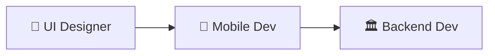

# iOS Swift Workflow - Quick Reference

One-page cheat sheet for building iOS native applications in Catalyst.

## Workflow Order (Design-First)



**Why Design-First?**
- UX drives requirements
- Mobile Dev defines backend contract
- Complete app works with mocks before backend exists
- Simple 1-line swap from mock → real APIs

---

## Phase 1: UI Designer

### Step 1: Wireframing
**Tools:** Mermaid, text-based wireframes, markdown

```markdown
┌─────────────────┐
│     [Logo]      │
│  [Text Field]   │
│  [   Button  ]  │
└─────────────────┘
```

**Deliverables:**
- User flow diagrams (Mermaid)
- Text-based wireframes
- Navigation architecture
- Information architecture

### Step 2: SwiftUI Implementation
**Tools:** Xcode, SwiftUI, Xcode Previews

**Creates:**
- `src/Views/*.swift` - Visual structure only
- `src/DesignSystem/*.swift` - Colors, Typography, Spacing
- Design specs (animations, gestures, navigation)

**Example:**
```swift
struct LoginView: View {
    @State private var email = ""
    var body: some View {
        VStack(spacing: 24) {
            TextField("Email", text: $email)
            Button("Log In") { /* Mobile Dev adds logic */ }
        }
        .padding(24)
    }
}
```

### Step 3: Design Validation
**Tools:** 5 CLI validation tools

```bash
# Grid compliance
ruby tools/grid_overlay.rb capture --simulator "iPhone 16" --grid 8

# Measurements
ruby tools/ruler_tool.rb measure --file screenshot.png --from 0,100 --to 0,144

# Colors
ruby tools/color_picker.rb verify --file screenshot.png --at 180,320 --design-system src/Colors.swift

# Professional screenshots
ruby tools/device_bezel.rb frame --file screenshot.png --device "iPhone 16 Pro"

# Animation demos
ruby tools/screen_recorder.rb record --duration 5 --gif --output animation.mov
```

**Deliverables:**
- SwiftUI Views (structure only)
- Design system files
- Validation proof-of-work
- Professional screenshots
- Animation demos

---

## Phase 2: Mobile Dev

### Step 1: Mock API Layer (FIRST!)

**Create protocol interface:**
```swift
// AuthServiceProtocol.swift
protocol AuthServiceProtocol {
    func login(email: String, password: String) async throws -> LoginResponse
}

// MockAuthService.swift
class MockAuthService: AuthServiceProtocol {
    func login(email: String, password: String) async throws -> LoginResponse {
        try await Task.sleep(nanoseconds: 1_000_000_000)
        return LoginResponse(
            accessToken: "mock-token-123",
            user: User(id: "1", name: "Test User")
        )
    }
}
```

**Backend API Contract Defined:**
- Exact request/response shapes
- Endpoint paths
- Error types
- Authentication flow

### Step 2: ViewModels & Logic

```swift
@MainActor
class LoginViewModel: ObservableObject {
    @Published var email = ""
    @Published var password = ""
    @Published var isLoading = false

    func login() async {
        isLoading = true
        defer { isLoading = false }
        // Call mock service
    }
}
```

### Step 3: Wire Views to ViewModels

```swift
struct LoginView: View {
    @StateObject private var viewModel = LoginViewModel()

    var body: some View {
        VStack {
            TextField("Email", text: $viewModel.email)
                .disabled(viewModel.isLoading)
            Button("Log In") {
                Task { await viewModel.login() }
            }
            .disabled(viewModel.isLoading)
        }
    }
}
```

### Step 4: BUILD-TEST LOOP

**Mandatory steps:**
1. Build: `xcodebuildmcp build and run`
2. Tests: Unit, integration, UI tests
3. Run in simulator
4. **Design validation** (5 tools: grid, ruler, color, bezel, recorder)
5. **Comprehensive testing** (ios-testing skill: simulator_control, screenshot_diff, test_matrix, pulse_logs)

**Deliverables:**
- Complete working app (with mocks)
- Backend API contract defined
- All tests passing
- Design validation complete
- Professional handoff screenshots

---

## Phase 3: Backend Dev

### Implementation

```python
@app.post("/auth/login")
async def login(request: LoginRequest) -> LoginResponse:
    user = await authenticate_user(request.email, request.password)
    access_token = create_access_token(user.id)
    return LoginResponse(
        access_token=access_token,
        user=user
    )
```

**Must match Mobile Dev's contract EXACTLY:**
- Same endpoint path: `/auth/login`
- Same request shape: `{ email, password }`
- Same response shape: `{ accessToken, user }`

**Deliverables:**
- Real API endpoints
- Database schema
- Authentication system
- API documentation

---

## Phase 4: Mobile Dev Swap

### Simple 1-Line Change

```swift
// Before (mock)
let authService: AuthServiceProtocol = MockAuthService()

// After (real)
let authService: AuthServiceProtocol = RealAuthService()
```

### RealAuthService Implementation

```swift
class RealAuthService: AuthServiceProtocol {
    func login(email: String, password: String) async throws -> LoginResponse {
        let response: LoginResponse = try await APIClient.shared.request(
            "/auth/login",
            method: .post,
            body: LoginRequest(email: email, password: password)
        )
        try KeychainManager.save(token: response.accessToken, key: "accessToken")
        return response
    }
}
```

### Final Tests

- Integration tests with real backend
- End-to-end tests
- Performance tests
- Security audit

**Deliverables:**
- Production-ready app
- All tests passing
- Ready for TestFlight/App Store

---

## Design Validation Tools

### 1. Grid Overlay (`grid_overlay.rb`)
**Purpose:** Verify 4px/8px grid compliance

```bash
ruby tools/grid_overlay.rb capture --simulator "iPhone 16" --grid 8 --output grid.png
```

### 2. Ruler Tool (`ruler_tool.rb`)
**Purpose:** Measure precise spacing

```bash
ruby tools/ruler_tool.rb measure --file screenshot.png --from 100,200 --to 300,400 --annotate
ruby tools/ruler_tool.rb interactive --file screenshot.png
```

### 3. Color Picker (`color_picker.rb`)
**Purpose:** Verify colors match design system

```bash
ruby tools/color_picker.rb verify --file screenshot.png --at 180,320 --design-system src/Colors.swift
ruby tools/color_picker.rb pick --at 180,320 --background "#FFFFFF" # Check contrast
```

### 4. Device Bezel (`device_bezel.rb`)
**Purpose:** Professional device frame screenshots

```bash
ruby tools/device_bezel.rb frame --file screenshot.png --device "iPhone 16 Pro" --background white --shadow
```

### 5. Screen Recorder (`screen_recorder.rb`)
**Purpose:** Animation demos

```bash
ruby tools/screen_recorder.rb record --duration 5 --gif --output animation.mov
```

---

## Testing Tools (ios-testing skill)

### Simulator Control (`simulator_control.rb`)
- Launch/reset/snapshot simulator states
- Network condition testing
- Status bar control (09:41 lock)

### Screenshot Diff (`screenshot_diff.py`)
- Visual regression testing
- Pixel-perfect comparison
- Automated alerts on changes

### Test Matrix (`ios_test_matrix.rb`)
- Multi-device testing
- Multiple iOS versions
- Parallel test execution

### Pulse Log Export (`pulse_log_export.rb`)
- Network request analysis
- API call verification
- Performance monitoring

---

## File Structure

```
MyApp/
├── src/
│   ├── Views/               # UI Designer creates
│   │   ├── LoginView.swift
│   │   └── DashboardView.swift
│   ├── ViewModels/          # Mobile Dev creates
│   │   ├── LoginViewModel.swift
│   │   └── DashboardViewModel.swift
│   ├── Services/            # Mobile Dev creates
│   │   ├── AuthServiceProtocol.swift
│   │   ├── MockAuthService.swift      # First!
│   │   └── RealAuthService.swift      # Later!
│   ├── DesignSystem/        # UI Designer creates
│   │   ├── Colors.swift
│   │   ├── Typography.swift
│   │   └── Spacing.swift
│   └── Config/              # Mobile Dev creates
│       └── Config.swift
├── docs/
│   ├── wireframes/          # UI Designer creates
│   ├── screenshots/         # UI Designer + Mobile Dev
│   └── animations/          # UI Designer + Mobile Dev
└── tests/                   # Mobile Dev creates
    ├── ViewModelTests/
    ├── ServiceTests/
    └── UITests/
```

---

## Key Principles

### Design-First Approach
✅ User experience drives everything
✅ Mobile Dev defines backend requirements
✅ Complete app works before backend exists
✅ Easy swap from mock to real APIs

### Mock-First Development
✅ Build complete app with mocks
✅ Define exact API contract
✅ Test everything with mock data
✅ Backend implements to specification

### Autonomous Validation
✅ CLI tools for objective verification
✅ No manual inspection needed
✅ Proof-of-work documentation
✅ Accessibility compliance built-in

### Agent Collaboration
✅ Clear handoff between agents
✅ Defined deliverables at each phase
✅ Documented validation requirements
✅ Professional quality standards

---

## Common Issues

### Grid Alignment
**Problem:** Elements not aligned to 8px grid
**Solution:** Use grid_overlay.rb to visually verify
**Fix:** Adjust padding/margins to multiples of 8

### Color Mismatch
**Problem:** Hard-coded colors instead of design system
**Solution:** Use color_picker.rb verify mode
**Fix:** Replace with design system color names

### Touch Targets
**Problem:** Buttons smaller than 44pt iOS minimum
**Solution:** Use ruler_tool.rb to measure
**Fix:** Set `.frame(height: 44)` on interactive elements

### Contrast Ratios
**Problem:** Text fails WCAG AA contrast (4.5:1)
**Solution:** Use color_picker.rb with --background flag
**Fix:** Adjust text/background color combination

---

## Related Documentation

- [Complete iOS Swift Workflow](/docs/workflows/ios-swift-workflow)
- [Wireframing Guide](/docs/workflows/wireframing-guide)
- [Design Validation Tools](/docs/DESIGN_VALIDATION_TOOLS.md)
- [Catalyst Mobile Design System](/docs/catalyst-mobile)

---

**Quick Start:**
1. UI Designer wireframes + SwiftUI → validates with 5 tools
2. Mobile Dev builds with mocks → defines backend contract
3. Backend Dev implements real APIs → matches contract
4. Mobile Dev swaps mock → real → deploys to TestFlight
