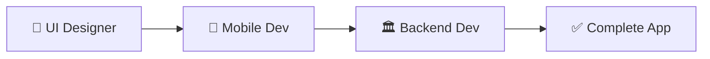
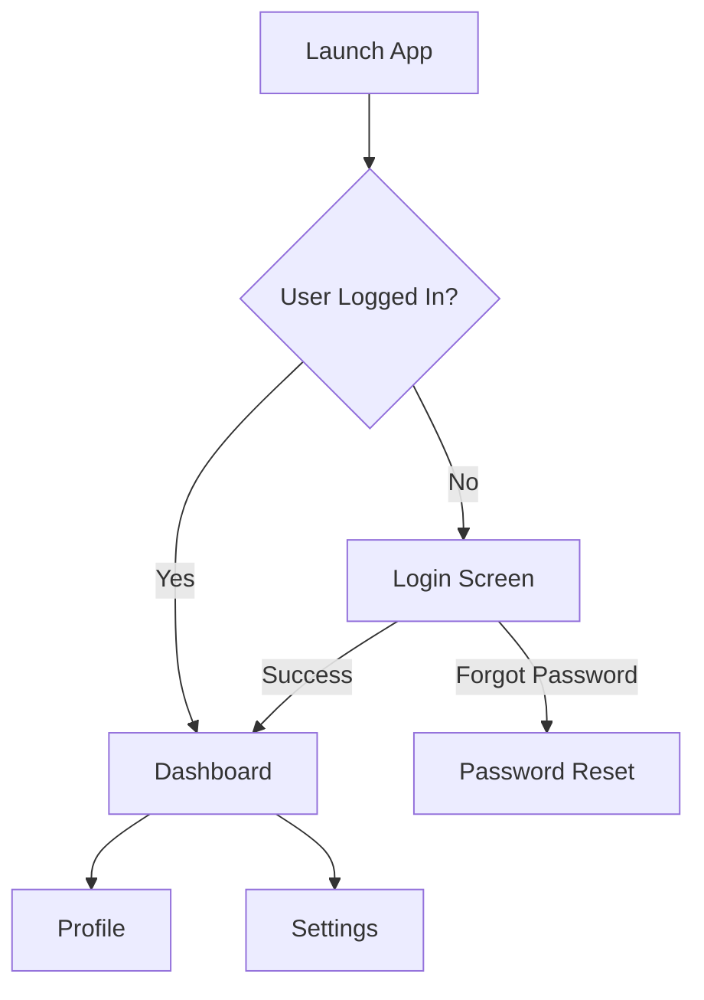

# iOS Native Swift Workflow

Complete end-to-end workflow for building iOS native applications with Swift and SwiftUI.

## Overview

Building iOS apps in Catalyst uses the **Design-First approach** with 3 specialized agents working in sequence:



**Why Design-First?**
- User experience drives requirements
- Mobile Dev defines backend contract
- Full app testing with mocks before backend exists
- Easy swap from mock to real APIs

## The Three Agents (In Order)

### 1. 📐 UI Designer Agent (Phase 1)

**Responsibilities:**
- Create user flows and wireframes
- Design information architecture
- Implement SwiftUI components
- Establish design system
- Validate designs with tools

**Three-Phase Process:**

#### Phase 1: Wireframing & User Flows

**Tools:** Mermaid diagrams, text-based wireframes, markdown

**Example User Flow:**


**Example Wireframe:**
```
┌─────────────────────────────┐
│         Logo                │
│                             │
│  ┌───────────────────────┐  │
│  │ Email                 │  │
│  └───────────────────────┘  │
│                             │
│  ┌───────────────────────┐  │
│  │ Password              │  │
│  └───────────────────────┘  │
│                             │
│  ┌───────────────────────┐  │
│  │      Log In           │  │
│  └───────────────────────┘  │
│                             │
│      Forgot Password?       │
└─────────────────────────────┘
```

**Documented in:** Docusaurus (this site)

#### Phase 2: SwiftUI Implementation

**Tools:** Xcode, SwiftUI, Xcode Previews

**What UI Designer Creates:**

```swift
// src/Views/LoginView.swift
struct LoginView: View {
    @State private var email = ""
    @State private var password = ""

    var body: some View {
        VStack(spacing: 24) {
            // Logo
            Image("logo")
                .resizable()
                .frame(width: 120, height: 120)

            // Email field
            TextField("Email", text: $email)
                .textFieldStyle(.roundedBorder)
                .autocapitalization(.none)

            // Password field
            SecureField("Password", text: $password)
                .textFieldStyle(.roundedBorder)

            // Login button
            Button("Log In") {
                // Mobile Dev adds logic here
            }
            .buttonStyle(.borderedProminent)
            .frame(height: 44) // iOS minimum touch target
        }
        .padding(24)
    }
}

#Preview {
    LoginView()
}
```

**Design System Files:**
- `src/DesignSystem/Colors.swift`
- `src/DesignSystem/Typography.swift`
- `src/DesignSystem/Spacing.swift`

**Documented in:**
- Docusaurus (design system specs)
- SwiftUI files (implementation)

#### Phase 3: Design Verification Loop

**Tools:** 5 CLI validation tools

1. **grid_overlay.rb** - Verify 4px/8px grid compliance
2. **ruler_tool.rb** - Measure spacing precisely
3. **color_picker.rb** - Verify design system colors + contrast
4. **device_bezel.rb** - Professional screenshots
5. **screen_recorder.rb** - Animation demos

**Example Validation:**
```bash
# Check grid compliance
ruby tools/grid_overlay.rb capture --simulator "iPhone 16" --grid 8

# Measure button height
ruby tools/ruler_tool.rb measure --file screenshot.png --from 100,400 --to 100,444

# Verify button color
ruby tools/color_picker.rb verify --file screenshot.png --at 180,420 --design-system src/Colors.swift

# Create handoff screenshot
ruby tools/device_bezel.rb frame --file screenshot.png --device "iPhone 16 Pro"

# Record animation
ruby tools/screen_recorder.rb record --duration 5 --output login_animation.mov --gif
```

**Deliverables:**
- SwiftUI Views (visual structure only)
- Design system files
- Animation/gesture/navigation specs
- Professional screenshots
- Animation demos
- Validation proof-of-work

**Documented in:** Docusaurus + validation reports

---

### 2. 📱 Mobile Dev Agent (Phase 2)

**Responsibilities:**
- Build complete app with **mock APIs** first
- Implement business logic and ViewModels
- Create mock API layer (fake responses)
- Define backend API contract (endpoints, data shapes)
- Set up authentication and security (with mocks)
- Handle data persistence
- Configure app lifecycle
- Comprehensive testing (all with mocks)
- Validate implementation matches design
- **Final step:** Swap mock APIs for real APIs

**What Mobile Dev Adds:**

#### 1. Mock API Layer (First!)

```swift
// src/Services/MockAuthService.swift
class MockAuthService: AuthServiceProtocol {
    func login(email: String, password: String) async throws -> LoginResponse {
        // Simulate network delay
        try await Task.sleep(nanoseconds: 1_000_000_000)

        // Return mock data
        if email == "test@example.com" && password == "password" {
            return LoginResponse(
                accessToken: "mock-token-123",
                refreshToken: "mock-refresh-456",
                user: User(id: "1", name: "Test User", email: email)
            )
        } else {
            throw AuthError.invalidCredentials
        }
    }
}

// src/Services/AuthServiceProtocol.swift
protocol AuthServiceProtocol {
    func login(email: String, password: String) async throws -> LoginResponse
}

// src/Services/RealAuthService.swift (implemented later)
class RealAuthService: AuthServiceProtocol {
    func login(email: String, password: String) async throws -> LoginResponse {
        // Real API call - implemented after backend is ready
        let response: LoginResponse = try await APIClient.shared.request(
            "/auth/login",
            method: .post,
            body: LoginRequest(email: email, password: password)
        )

        try KeychainManager.save(token: response.accessToken, key: "accessToken")
        return response
    }
}
```

#### 2. ViewModels (Business Logic)

```swift
// src/ViewModels/LoginViewModel.swift
@MainActor
class LoginViewModel: ObservableObject {
    @Published var email = ""
    @Published var password = ""
    @Published var isLoading = false
    @Published var errorMessage: String?

    func login() async {
        isLoading = true
        defer { isLoading = false }

        do {
            _ = try await AuthService.login(email: email, password: password)
            // Navigate to dashboard
        } catch {
            errorMessage = error.localizedDescription
        }
    }
}
```

#### 3. Updated View (Wired to Backend)

```swift
// src/Views/LoginView.swift (Mobile Dev updates)
struct LoginView: View {
    @StateObject private var viewModel = LoginViewModel()

    var body: some View {
        VStack(spacing: 24) {
            Image("logo")
                .resizable()
                .frame(width: 120, height: 120)

            TextField("Email", text: $viewModel.email)
                .textFieldStyle(.roundedBorder)
                .disabled(viewModel.isLoading)

            SecureField("Password", text: $viewModel.password)
                .textFieldStyle(.roundedBorder)
                .disabled(viewModel.isLoading)

            Button("Log In") {
                Task { await viewModel.login() }
            }
            .buttonStyle(.borderedProminent)
            .frame(height: 44)
            .disabled(viewModel.isLoading)

            if viewModel.isLoading {
                ProgressView()
            }

            if let error = viewModel.errorMessage {
                Text(error).foregroundStyle(.red)
            }
        }
        .padding(24)
    }
}
```

#### 4. Configuration

```swift
// src/Config/Config.swift
enum Config {
    static let apiBaseURL: String = {
        #if DEBUG
        return "https://api-dev.myapp.com"
        #else
        return "https://api.myapp.com"
        #endif
    }()

    static let environment = Environment.production
}
```

#### 5. BUILD-TEST LOOP (Mandatory)

**Steps:**
1. Build with xcodebuildmcp
2. Run tests (unit, integration, UI)
3. Run in simulator with real backend
4. Design validation with 5 tools:
   - grid_overlay.rb → Verify spacing
   - ruler_tool.rb → Check measurements
   - color_picker.rb → Validate colors
   - device_bezel.rb → Handoff screenshots
   - screen_recorder.rb → Demo animations
5. Comprehensive testing (ios-testing skill):
   - simulator_control.rb → Environment testing
   - screenshot_diff.py → Visual regression
   - ios_test_matrix.rb → Multi-device
   - pulse_log_export.rb → Network analysis

**Deliverables:**
- Complete iOS app with backend integration
- All tests passing
- Design validation complete
- Professional handoff screenshots
- Animation demos
- Ready for TestFlight/App Store

**Documented in:** Docusaurus + test reports

---

## Complete Example: Login Screen

### 1. UI Designer Creates Wireframe

```
Login Screen Wireframe:

┌─────────────────────────────┐
│                             │
│         [App Logo]          │
│                             │
│  ┌───────────────────────┐  │
│  │ Email                 │  │
│  └───────────────────────┘  │
│                             │
│  ┌───────────────────────┐  │
│  │ Password              │  │
│  └───────────────────────┘  │
│                             │
│  ┌───────────────────────┐  │
│  │      Log In           │  │
│  └───────────────────────┘  │
│                             │
│   [Forgot Password?]        │
│                             │
└─────────────────────────────┘

Spacing:
- Logo top margin: 44pt
- Logo size: 120x120pt
- Input fields: 16pt spacing
- Button height: 44pt (iOS minimum)
- Side padding: 24pt
```

**Then implements in SwiftUI with Xcode Previews**

**Validates with tools:**
- Grid overlay ✅
- Ruler measurements ✅
- Color verification ✅

**Delivers:**
- LoginView.swift (visual structure)
- Design system files
- Professional screenshots
- Animation specs

### 2. Mobile Dev Builds with Mock APIs

**Adds:**
- LoginViewModel.swift (business logic)
- MockAuthService.swift (fake API responses)
- AuthServiceProtocol (interface for mock/real swap)
- KeychainManager.swift (secure token storage)
- Config.swift (API URLs)
- Error handling
- Loading states
- Navigation

**Defines Backend API Contract:**
```swift
// Mobile Dev specifies EXACTLY what backend must provide:
protocol AuthServiceProtocol {
    func login(email: String, password: String) async throws -> LoginResponse
}

struct LoginResponse: Codable {
    let accessToken: String
    let refreshToken: String
    let user: User
}
```

**Tests with Mocks:**
- Unit tests with MockAuthService
- Integration tests with mock data
- UI tests for complete flow
- Design validation with tools

**Delivers:**
- Complete working app (with mocks)
- Backend API contract defined
- All tests passing
- Ready for backend integration

### 3. Backend Dev Implements Real API

```python
# Backend API (FastAPI)
# Implements EXACT contract defined by Mobile Dev
@app.post("/auth/login")
async def login(request: LoginRequest) -> LoginResponse:
    user = await authenticate_user(request.email, request.password)
    if not user:
        raise HTTPException(status_code=401, detail="Invalid credentials")

    access_token = create_access_token(user.id)
    refresh_token = create_refresh_token(user.id)

    return LoginResponse(
        access_token=access_token,
        refresh_token=refresh_token,
        user=user
    )
```

**Delivers:**
- API URL: `https://api.myapp.com/auth/login`
- Request: `{ "email": "user@example.com", "password": "..." }`
- Response: `{ "accessToken": "...", "refreshToken": "...", "user": {...} }`
- **Matches Mobile Dev's contract exactly**

### 4. Mobile Dev Swaps Mock → Real

**Simple 1-line change:**
```swift
// Before (mock)
let authService: AuthServiceProtocol = MockAuthService()

// After (real)
let authService: AuthServiceProtocol = RealAuthService()
```

**Final Tests:**
- Integration tests with real backend
- End-to-end tests
- Performance tests
- Security audit

**Delivers:**
- Complete production-ready login
- All tests passing
- Ready for TestFlight/App Store

---

## Documentation Locations

### Design Documentation (Docusaurus)
- **Wireframes:** `/docs/workflows/wireframes/`
- **User Flows:** `/docs/workflows/user-flows/`
- **Design System:** `/docs/catalyst-mobile/design-system/`
- **Components:** `/docs/catalyst-mobile/primitives/`
- **Screens:** `/docs/catalyst-mobile/screens/`

### Implementation (Code)
- **Views:** `src/Views/`
- **ViewModels:** `src/ViewModels/`
- **Services:** `src/Services/`
- **Design System:** `src/DesignSystem/`

### Validation (Proof-of-Work)
- **Screenshots:** `docs/screenshots/`
- **Animations:** `docs/animations/`
- **Test Reports:** `docs/test-reports/`

---

## Tools Reference

### Backend Dev Tools
- xcodebuildmcp (API testing)
- Postman/Insomnia (API development)
- Supabase CLI

### UI Designer Tools
- Xcode (SwiftUI development)
- xcodebuildmcp (build & run)
- **5 Design Validation Tools:**
  - grid_overlay.rb
  - ruler_tool.rb
  - color_picker.rb
  - device_bezel.rb
  - screen_recorder.rb

### Mobile Dev Tools
- Xcode (full implementation)
- xcodebuildmcp (build, test, run)
- ios-testing skill (automated testing)
- **4 Testing Tools:**
  - simulator_control.rb
  - screenshot_diff.py
  - ios_test_matrix.rb
  - pulse_log_export.rb
- **5 Design Validation Tools** (same as UI Designer)

---

## Next Steps

1. **Start with wireframes** - UI Designer creates user flows
2. **Design mockups** - UI Designer implements SwiftUI components
3. **Validate design** - UI Designer uses 5 validation tools
4. **Build with mocks** - Mobile Dev creates complete app with mock APIs
5. **Define backend contract** - Mobile Dev specifies exact API requirements
6. **Implement backend** - Backend Dev builds real APIs to contract
7. **Swap mock → real** - Mobile Dev switches to real APIs
8. **Test thoroughly** - All validation tools, integration tests
9. **Deploy** - TestFlight → App Store

---

**Related Documentation:**
- [Mobile App Workflow](/docs/workflows/mobile-app-workflow)
- [Design Validation Tools](/docs/workflows/design-validation-tools)
- [iOS Pattern Guides](/docs/workflows/ios-patterns)
- [Catalyst Mobile Design System](/docs/catalyst-mobile)
